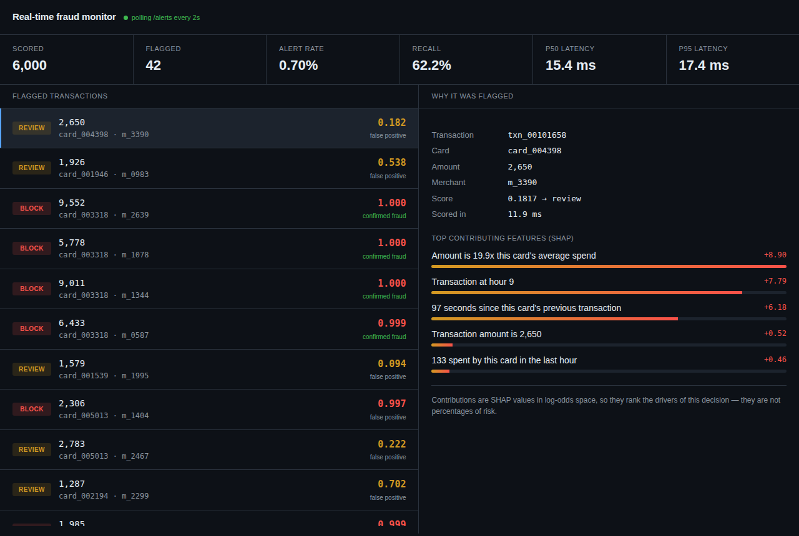

# Real-time fraud detection with explanations

Scores card transactions as they arrive and returns **why** each one was flagged,
not just a number. Velocity features are computed live from Redis; explanations
come from SHAP values on the model's own decision.



**On a held-out time split: 75% of fraud caught at a 0.5% review rate, p95 latency 17ms.**

---

## The number that matters

Accuracy on a dataset that is 99.6% legitimate is 99.6% for a model that does
nothing. ROC-AUC looks great for the same reason. The metric a fraud team
actually buys is:

> *If my analysts can review 0.5% of transactions a day, what fraction of fraud
> do I catch?*

That is recall at a fixed alert budget, and it is what `train.py` reports:

```
PR-AUC        0.7756
ROC-AUC       0.9492   (ignore this, it flatters imbalanced data)

At a 0.5% review rate (threshold 0.032):
  recall      75.2%
  precision   70.8%
```

## Architecture

```
simulator ──POST /score──► FastAPI ──► Redis (sliding-window features)
                              │
                              ├──► LightGBM  ──► probability
                              └──► SHAP      ──► top 5 reasons
                              │
dashboard ◄──GET /alerts──────┘
```

### Why Redis and not a feature table

The model needs answers about the *recent past* at the moment a transaction
arrives: how many times has this card been used in the last 60 seconds, how does
this amount compare to its rolling average, is this device new. A SQL aggregate
over a transactions table takes hundreds of milliseconds and gets worse as
history grows.

Redis sorted sets keyed by card, scored by timestamp, make a sliding window a
`ZCOUNT` — O(log N), flat as history grows, single-digit milliseconds. That layer
is `app/features.py` and it is the part of this project worth reading.

### Why no Kafka

One producer, one consumer, no replay-from-offset requirement and no consumer
group to rebalance. A broker here would be ceremony. The pieces that would
actually need Kafka — multiple consumers, replay, backpressure across services —
don't exist at this scale, and adding it would obscure the part that does matter.

## Three things that are easy to get wrong

**1. Never let a transaction contribute to its own features.** `/score` reads the
window, scores, explains, and only *then* records the transaction. Reversed, your
offline metrics look superb and the live service quietly degrades — the model
learned from a count that already included the row it was predicting.

**2. Split by time, not randomly.** Fraud arrives in bursts. A shuffled test set
contains transactions from the same attack the model trained on, so it is
recognising an attack it has already seen rather than generalising.

**3. Event time, not processing time.** `/score` accepts an optional `event_time`.
Replaying a historical log at 300 txn/sec against wall-clock windows squashes
every card's history into one second and the velocity features become noise. Real
systems hit the same problem with delayed and out-of-order events.

## Run it

```bash
pip install -r requirements.txt
redis-server --save "" --appendonly no --daemonize yes

python make_data.py --out data/transactions.csv --n 120000   # synthetic data
python train.py --csv data/transactions.csv                  # prints the threshold

REVIEW_THRESHOLD=0.032 uvicorn app.main:app --port 8000      # use printed value
python simulate.py --rate 20 --skip 96000                    # replay unseen rows
python -m http.server 8099                                   # open dashboard.html
```

Or `docker compose up` for Redis + API, then run the simulator on the host.

### Using real data

`make_data.py` generates a synthetic log whose fraud is velocity-shaped (card
testing bursts, patient spread-out fraud, and quiet single transactions that no
velocity feature can catch — kept in deliberately so recall stays honest). To use
[IEEE-CIS](https://www.kaggle.com/c/ieee-fraud-detection) or
[PaySim](https://www.kaggle.com/datasets/ealaxi/paysim1) instead, map the columns
to `txn_id, timestamp, card_id, amount, merchant, merchant_category, device_id,
country, label` and nothing downstream changes.

## API

```bash
curl -X POST localhost:8000/score -H 'content-type: application/json' -d '{
  "txn_id":"t1","card_id":"card_000042","amount":48000,
  "merchant":"m_8100","merchant_category":"gift_cards","device_id":"dev_999001"
}'
```

```json
{
  "fraud_probability": 0.94,
  "decision": "block",
  "reasons": [
    {"text": "Amount is 11.3x this card's average spend", "contribution": 8.90},
    {"text": "4 transactions from this card in the last 60 seconds", "contribution": 6.18},
    {"text": "Device never seen before for this card", "contribution": 1.29}
  ],
  "latency_ms": 12.4
}
```

`GET /alerts` feeds the dashboard, `GET /stats` reports live recall and latency
percentiles, `GET /health` checks Redis and the model.

## Notes and limits

- **SHAP values are log-odds, not percentages.** The UI ranks them and says so.
  Presenting `+8.90` as "this added 890% risk" would be wrong.
- **Live recall reads lower than offline recall** on a short replay: cards start
  with empty history in Redis, so velocity features are cold. Warm up by replaying
  the training rows first, or quote the offline number, which is the honest one.
- **Class weighting, not SMOTE.** Synthetic oversampling distorts the predicted
  probabilities, and the whole threshold-tuning step depends on them meaning
  something.
- The in-memory alert buffer is a demo convenience; production writes alerts to
  Postgres so they survive a restart and can be labelled by analysts later.

## Layout

```
app/features.py   Redis sliding-window feature store   <- the interesting part
app/explain.py    SHAP -> analyst-readable sentences
app/main.py       /score, /alerts, /stats
train.py          point-in-time replay, time split, threshold tuning
make_data.py      synthetic labelled transaction log
simulate.py       replays the log against the API
dashboard.html    live alert feed + per-alert explanation
```
